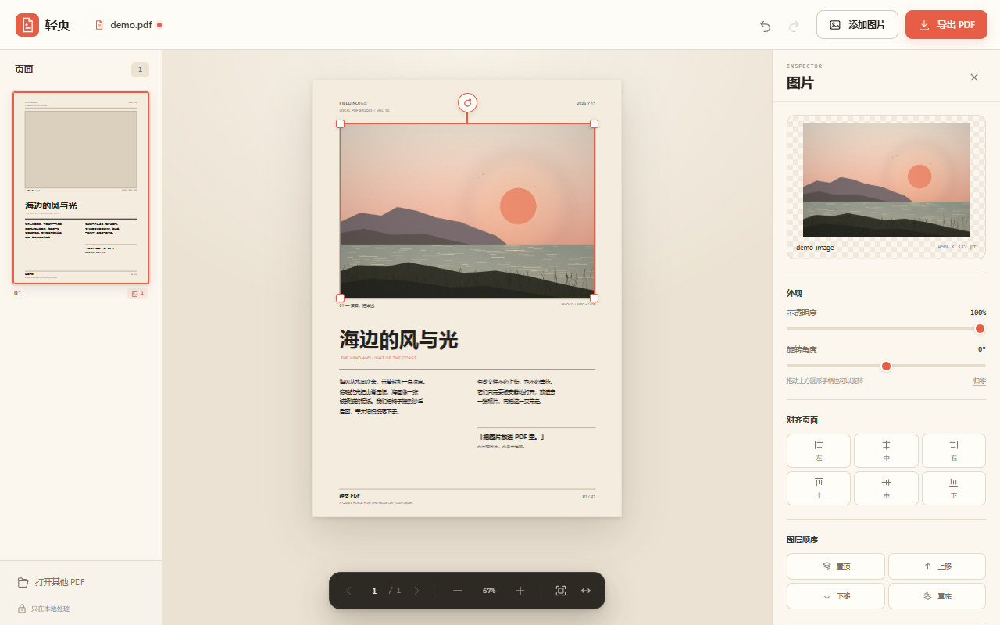

# 轻页 PDF

一个不登录、不上传的本地 PDF 图片编辑器。打开 PDF，把图片放进去，调好位置，再导出。

**在线使用**：<https://talos1899.github.io/qingye-pdf/>

## 为什么做这个

在线 PDF 工具通常要上传文件、注册账号，或者依赖不稳定的外网服务。轻页 PDF 把 PDF 解析、图片处理和导出全部放在浏览器里完成：

- 不需要账号
- 不把 PDF 或图片上传到服务器
- 不加水印
- 不依赖 CDN；下载 `index.html` 后断网也能用

页面本身从 GitHub Pages 加载，但你在编辑器里打开的 PDF 和图片不会离开当前浏览器标签页。

## 现在能做什么

- 添加图片：选择文件、拖进页面、直接粘贴
- 拖动移动；拖四角缩放（默认锁定比例，按住 `Shift` 自由拉伸）
- 拖动上方手柄旋转，接近 90° 整数倍自动吸附
- 调整不透明度、六向对齐、图层顺序
- 复制、替换、删除，60 步撤销/重做
- 页面缩略图、翻页、缩放、适应页面/适应宽度
- 导出时保留原 PDF 页面：原有文字、矢量图、链接和表单内容不会被整页截图替换
- 支持带 `/Rotate`（0°/90°/180°/270°）和裁剪偏移的页面
- 手机/窄屏布局

支持 JPG、PNG、WebP、GIF、AVIF、BMP；透明背景会保留。图片最长边超过 4096px 时会先在本地缩小，避免浏览器内存吃紧。

## 使用

1. 打开在线地址，或下载仓库里的 `index.html` 双击打开（推荐 Chrome / Edge）。
2. 点「打开 PDF」，选择文件；也可以直接把 PDF 拖进页面。
3. 点「添加图片」，或者把图片拖进来 / 直接粘贴。
4. 拖动、缩放、旋转图片，右侧调整样式、对齐和图层。
5. 点「导出 PDF」下载新文件。原 PDF 不会被修改。

`examples/` 里有一份示例 PDF 和一张插画，可以直接拿来试。

## 快捷键

| 操作 | 快捷键 |
| --- | --- |
| 撤销 / 重做 | `Ctrl/Cmd + Z` / `Ctrl/Cmd + Shift + Z` |
| 导出 PDF | `Ctrl/Cmd + S` |
| 打开其他 PDF | `Ctrl/Cmd + O` |
| 复制选中图片 | `Ctrl/Cmd + D` |
| 删除选中图片 | `Delete` / `Backspace` |
| 微调位置 | 方向键（`Shift` + 方向键 = 10pt） |
| 取消选择 | `Esc` |
| 翻页 | `PageUp` / `PageDown` |
| 缩放 | `+` / `-` |

## 目前不做

- **不改 PDF 里已有的文字**。重新排版文本容易破坏原文件，这一版没有硬做。
- **不做 OCR**。扫描版 PDF 可以当底图放图片，但不会识别文字。
- **不做 PDF 转 Word / Excel**，也不做压缩、合并、拆分。
- 不支持加密或需要密码的 PDF。
- 特别大的文件受浏览器内存限制；超大扫描页可能较慢。

文本编辑和格式转换在后续路线图里。先把图片编辑做稳定，比一次堆很多半成品更可靠。

## 开发说明

这个仓库当前只发布构建后的单文件应用，根目录 `index.html` 就是完整产物：

- PDF 渲染：PDF.js 3.11.174
- PDF 写出：pdf-lib 1.17.1
- worker、CMap 和标准字体全部内联，运行时没有外部网络请求

构建后的 HTML 约 4.8 MB。测试使用本机 Edge 和 Playwright，覆盖图片交互、四方向旋转页导出、完全离线运行和在线发布版本。

## 第三方组件

- PDF.js 3.11.174 — Apache-2.0
- pdf-lib 1.17.1 — MIT
- PDF.js CMap 数据 — Adobe BSD-style
- PDF.js 标准字体（Foxit / Liberation）— PDFium BSD-style / SIL OFL 1.1

完整许可文本见 `third_party/`，组件说明见 [THIRD_PARTY_NOTICES.md](THIRD_PARTY_NOTICES.md)。转发或分发时请一起保留。

---

轻页 PDF v0.1 · 图片编辑版 · 本地优先
